Title: Sites I've worked on
Slug: sites
Status: published

		  <h1>Design and development work</h1><h2>Django Work</h2><table cellpadding="1" border="0" cellspacing="1"><tr><td valign="top"><h3>This site (obviously)</h3>Django 1.8.4 web app framework Haystack 2.0.0 beta search middleware custom  		  coded apps for reviews, projects, quotes, blog, rss feed</td><td valign="top"><h3>The Plus Side</h3>Site for unproduced web series on fashion and style for plus sized women.<a href="/static/portfolioimgs/plusside.png"> 		  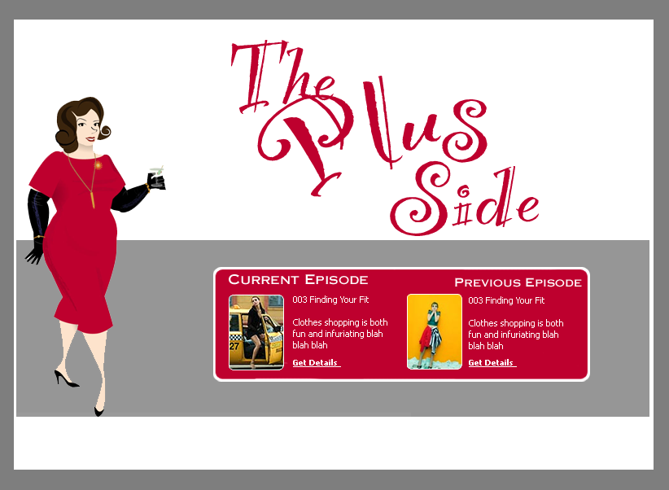</a></td></tr><tr><td colspan="2"><h2>PHP Work</h2></td></tr>		<tr>			<td><h3>changescape</h3> 			 Developed site for IT consulting company,  		  including event management application (infopages, registration, reporting). <a href="/static/portfolioimgs/cslayout.jpg">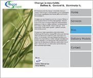</a></td>					 		  <td><h3>Resolve St. Louis</h3> 			 Developed portal for local chapter of the national infertility support group. Site offered newsletter archive, mailing list management, forms for volunteers, calendar of events, news from the 		   field, education resources, and a custom written message board.			 <a href="/static/portfolioimgs/resolve.jpg">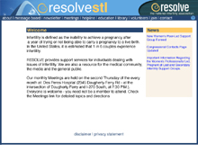</a></td>		</tr>		<tr>	 		   		<td><h3>Christ United Church of Christ</h3> 			Designed and coded. Community site for members and potential members of the church. Included extensive educational and missionary related resources, newsletters, regularly updated news. 	 							 <a href="/static/portfolioimgs/ucc.jpg">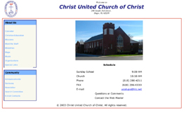</a></td>					<td><h3>Procreative Cryobank</h3>  			Designed and coded in php.  							Medical service website to allow clients to view lists of available donors, to bank their own samples, and to get information from the office.			 <a href="/static/portfolioimgs/procreative2.jpg"> 							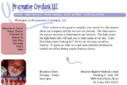</a></td>		</tr>		<tr>			<td><h3>Total Health Concepts</h3> Designed and coded. Therapist and mental health  							services website.  <a href="/static/portfolioimgs/totalhealth.jpg">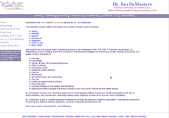</a></td>					<td><h3>Lizabella Design</h3>  			 							Designed and coded. Online portfolio of custom announcement company. Included extensive photo galleries and a comprehensive order process. <a href="/static/portfolioimgs/lizabella.jpg"> 							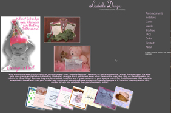</a></td>		</tr><tr><td colspan="2"><h2>Zope Work</h2></td></tr><tr>			<td><h3>St Louis New Parents Network</h3>Designed and 							 coded in Zope. Informational resource for parents, including extensive forms, guides, recipes, sample schedules, quarterly newsletters, contact lists, calendar of events, photo gallery. CMF based site. 				 							  <a href="/static/portfolioimgs/stlparents.jpg">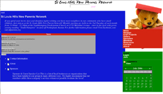</a></td>					<td><h3>PlanetCAD</h3>Portal site for Spatial 							  Technologies (now a division of Dassault). Coded layout, ad banner managment system, RSS feed display, meta site search across the Spatial domains (3dShare, 3dPublish, bits2parts), user management, press release management, 							   threaded discussions. 3dShare won IEEE Computer Society, Top 10 Software Products 2000, Silver Product of the Year, NASA TechBriefs 1999-2000, and CADENCE Magazine Best New Technology [3Dmodelserver], 1999 .			 							    <a href="/static/portfolioimgs/planetCAD.jpg">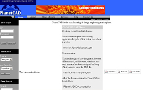</a></td>		</tr>		<tr>			<td><h3>3dPublish</h3>Coded layout, 							    registration, user management, knowledge managment, RSS feed display, ad banner management system for model healing service and news site. 				  								<a href="/static/portfolioimgs/3dPublish.jpg">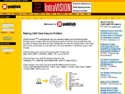</a></td>					<td><h3>Schopp Racing</h3>Designed and coded.  								Informational site for Formula Vee racer Jerry Schopp. Custom CMF with dynamic photo album..			 <a href="/static/portfolioimgs/SchoppRacing.jpg">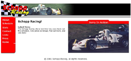</a></td>		</tr><tr><td colspan="2"><h2>Design Work and ASP/Cold Fusion Work</h2></td></tr><tr>			<td><h3>Cheesecake And Muffin Company</h3>Prototyped brochure site, added  								 online store. ASP and Microsoft SQL Server 6.5 <a href="/static/portfolioimgs/cheesecakelayout.jpg">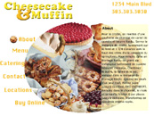</a></td>				 								 	<td><h3>Fantasy Elections</h3>Developed complete online fantasy sports game, all design and code. User, team, and league management. Candidate, Party, and State management tools for all US Congressional Representatives, Senators, 									 and US States as well as system administration tools. Database design, optimization and administration. Ad banner management system, RSS feeds, search functionality, user registration and validation. 				 									  <a href="/static/portfolioimgs/feclayout.jpg">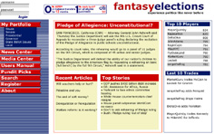</a></td>		</tr>		<tr>			 									 <td><h3>Colorado Community College Online</h3>Update design, coded front end/registration/multi-campus dynamic content. Migrated from Cold Fusion to ASP. <a href="/static/portfolioimgs/ccconline.jpg"> 									 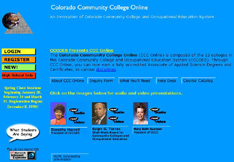</a></td>					<td><h3>Symphony/Network Now</h3>Designed and coded internal trouble ticket entry/tracking system.  									 ASP with Perl backend running against Oracle on Solaris. 	Expanded to become a  modular trouble ticket tracking/entry system to be rebranded for large customers			 <a href="/static/portfolioimgs/symphony.jpg"> 									 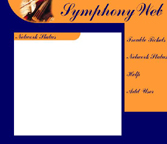</a></td>		</tr><tr><td colspan="2"><h2>eCollege Design/front end coding work </h2></td></tr><tr>			 									 <td><h3>ED USA</h3> 			 <h3>Hope University</h3>  									 <a href="/static/portfolioimgs/hope.jpg">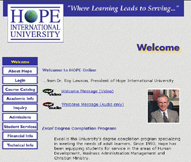</a> <h3>Keller Online</h3> 		 									 <a href="/static/portfolioimgs/keller.jpg">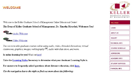</a></td>			<td><h3>Colorado School of Mines</h3> 	 									 	<a href="/static/portfolioimgs/Mines1%28codeonly%29.jpg">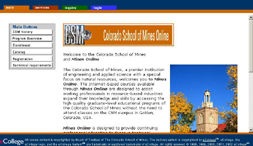</a> <h3>Monmouth</h3> 	 											<a href="/static/portfolioimgs/monmouth.jpg">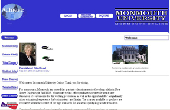</a> <h3>National University</h3> 		 											</td>		</tr>		<tr>			<td><h3>Pace</h3> 	 												<a href="/static/portfolioimgs/pace%28codeonly%29">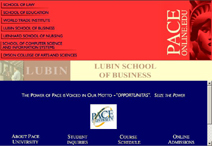</a> <h3>Phoenix Academies</h3> 		 												<a href="/static/portfolioimgs/phoenix.jpg">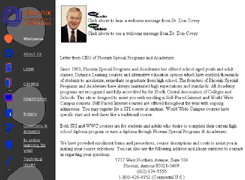</a> <h3>Rogers University</h3> 		 												</td>			<td><h3>University of Northern Colorado</h3> 	 												 													<a href="/static/portfolioimgs/unc.jpg">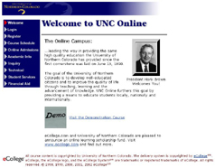</a> <h3>Seton Hall</h3> 		 															</td>			<td/>	 														</tr><tr><td colspan="2"><h2>Other Design Work</h2></td></tr><tr><td><h3>Algernon Photography</h3>  														 </td><td><h3>Diamond Dogs Photography</h3> </td></tr><tr><td><h3>Colorado Young Democrats</h3>  														 <h3>Infotasia Logo</h3></td><td><h3>Smallworld Project Plan</h3> <h3>Sperber Hotel Newsletter</h3></td></tr></table>
